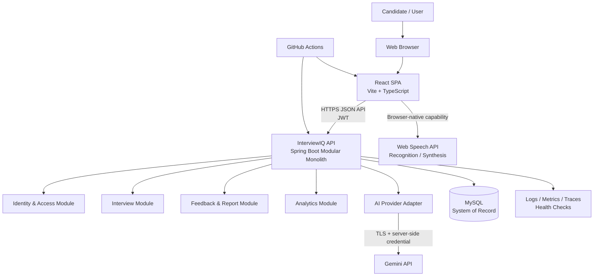
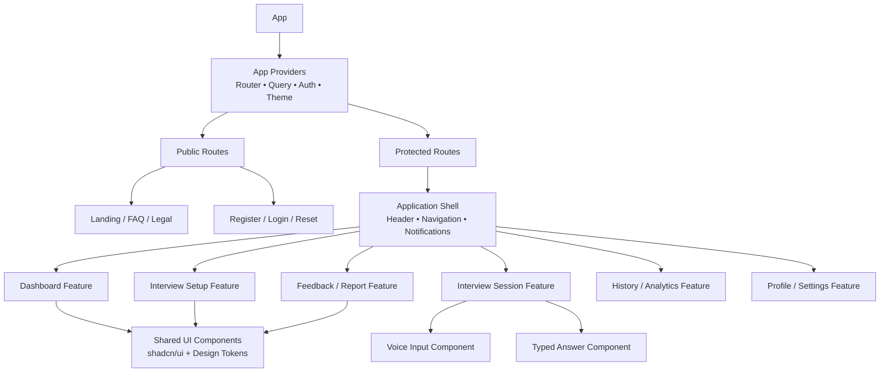
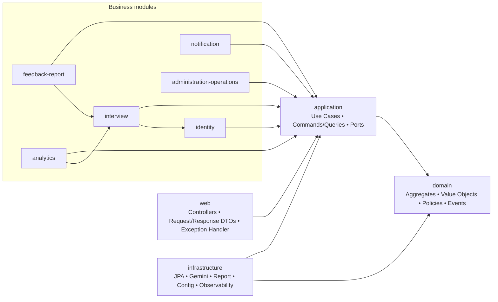
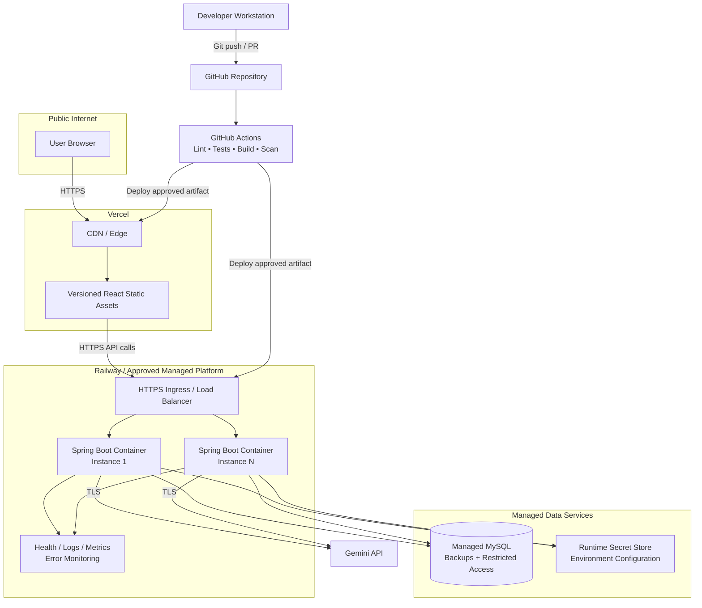

# InterviewIQ AI — System Architecture

**Document status:** Draft for Phase 0 architecture review  
**Architecture decision:** Modular monolith for MVP  
**Primary stack:** React/Vite/TypeScript; Java 21/Spring Boot 3; MySQL; Gemini API; Web Speech API

## Executive Summary

InterviewIQ AI will be delivered as a secure, production-ready SaaS platform built around a browser client, a Java/Spring Boot modular monolith, a MySQL system of record, and isolated integrations for Gemini and browser-native speech capabilities. The design deliberately optimizes for rapid MVP learning without sacrificing the boundaries, security controls, observability, and operational discipline required for a future scale-up.

The backend owns all business rules, user authorization, persistence, AI-provider credentials, lifecycle transitions, and report generation. The frontend provides a responsive, accessible interview experience and never connects directly to MySQL or Gemini. AI and voice capabilities are treated as unreliable external dependencies: outputs are validated, failures are recoverable, and typed answers remain a complete path when speech recognition is unavailable.

## Architectural Goals

- Deliver the full self-service journey: secure account access, interview configuration, voice/text answers, AI feedback, history, analytics, and report export.
- Keep user data private through server-side authorization, secure secrets handling, TLS, input/output validation, and least privilege.
- Create clear domain boundaries so the MVP remains comprehensible and testable as it grows.
- Isolate Gemini, voice, report, and infrastructure concerns behind application interfaces.
- Support safe operations through health checks, structured logs, correlation IDs, metrics, migration discipline, CI, backup/recovery procedures, and environment parity.
- Enable horizontal application scaling and a low-risk path to selectively extract services only when justified by scale or organizational need.

## Quality Attributes

### Scalability

The Spring Boot application is stateless except for durable data in MySQL and can be scaled horizontally behind a managed platform/load balancer. API endpoints are user-scoped, indexed, and paginated/bounded where data may grow. AI workload is isolated behind a provider adapter with quotas, concurrency controls, and retry/backoff. The design avoids distributed systems complexity until independently scalable workloads justify it.

### Performance

The architecture targets p95 non-AI API response time of 500 ms or less under normal load and frontend interactive readiness within 3 seconds on typical broadband. AI generation is inherently variable; it is modelled as a bounded external operation with a visible pending state rather than blocking the UI indefinitely. Database queries are designed around indexed user ownership and interview status/date access patterns.

### Security

All production communication uses TLS. The backend enforces authentication, token validation, resource ownership, validation, and safe state transitions. Passwords use adaptive hashing; secrets are runtime configuration only. Gemini is never invoked directly by the browser. AI output is treated as untrusted data and schema-validated before persistence/rendering. Logs are scrubbed of credentials, tokens, and unnecessary answer content.

### Reliability

Interview answers, lifecycle transitions, feedback status, and report state are durable. Database transactions protect local state changes. Retries use idempotency-safe semantics, and AI failures leave the interview in an accurate recoverable state. Health checks, error monitoring, backups, and runbooks support recovery.

### Maintainability

The modular monolith uses explicit package/domain boundaries, dependency direction, DTOs at interfaces, central exception handling, database migrations, code formatting/linting, automated tests, and documented API contracts. Framework details remain at adapter layers where practical, leaving business rules testable without HTTP or provider dependencies.

### Extensibility

Provider abstractions allow Gemini models or AI vendors to change. Prompt templates are versioned artifacts. Interview templates, roles, scoring rubrics, notifications, reporting formats, and configuration catalogs are designed as controlled extension points. Domain modules can later be extracted along operational seams without a full rewrite.

## Architecture Style

### Modular Monolith

The MVP uses a single deployable Spring Boot application split into cohesive, independently testable domain modules. Modules communicate through application-level interfaces and explicit domain contracts, not arbitrary cross-package repository access. The frontend is independently deployed but consumes a single versioned backend API.

This approach provides transactions, simple deployment, direct debugging, a single data model, predictable local development, and faster iteration—critical when product requirements, AI prompts, and user behavior are still being validated.

### Why Not Microservices for the MVP

Microservices would introduce service discovery, distributed tracing across deployments, network failure modes, eventual consistency, contract/version coordination, multiple CI/CD pipelines, and a higher operational burden. The MVP has a small team, tightly coupled core workflows (interview → answers → feedback → report), and no demonstrated independent scaling requirement. These costs would slow learning without delivering proportional value.

The selected monolith is not an unstructured monolith. Bounded module interfaces, event-ready seams, provider adapters, and operational metrics preserve a credible route to extract AI processing, reporting, notifications, or analytics when scale and team structure warrant it.

## High-Level Architecture



**Trust boundary:** Browser code is untrusted. It may request only authenticated API operations and browser speech functions. The backend is the authority for user identity, ownership, state transitions, database access, report creation, prompt construction, and Gemini invocation.

## Frontend Architecture

### React, Vite, and TypeScript

The frontend is a React single-page application built with Vite and strict TypeScript. Vite provides fast local iteration and optimized production assets; TypeScript makes API models, UI state, and component contracts explicit. Tailwind CSS and shadcn/ui provide a consistent accessible design system without coupling domain logic to visual components.

### Routing

A client-side router separates public and authenticated route groups. Route guards redirect unauthenticated users to login, preserve an approved return destination, and never substitute for server-side authorization. Primary routes include public landing/legal pages, authentication, dashboard, setup, interview session, feedback/report detail, history/analytics, profile, and settings.

### State Management

- **Server state:** TanStack Query owns API caching, invalidation, loading/error states, retries, and optimistic updates only where safe.
- **Local UI state:** React state/hooks manage form values, modal visibility, transcript edits, and page-specific interaction state.
- **Cross-cutting client state:** A minimal typed store/context may manage authentication presentation state, feature flags, and user preferences. It must not duplicate authoritative server data.
- **Forms:** A schema-backed form approach validates user input for usability; backend validation remains authoritative.

### API Layer

A single typed API client layer owns base URL configuration, authentication transport, request correlation where applicable, response parsing, and conversion of backend errors into stable client error types. Feature modules call domain-specific API functions; UI components do not construct raw HTTP requests. API contracts are generated or manually synchronized from the approved OpenAPI specification.

### Authentication

The client uses the approved JWT transport strategy (to be finalized by ADR). It must avoid exposing secrets, attach credentials only to intended API origins, react predictably to expiry, clear client state on logout, and protect navigation. Sensitive authorization decisions are never made solely in the frontend.

### Component Structure

The UI follows feature-first organization: reusable design-system components, application shell components, and domain feature components/hooks are separate. Presentation components receive typed data/handlers; API calls and business coordination remain in feature hooks/controllers.



## Backend Architecture

### Spring Boot Application Structure

Spring Boot 3 on Java 21 hosts one modular application. Each module owns its application services, domain model, persistence mappings, and inbound/outbound adapters. Dependencies point inward: HTTP controllers and JPA/provider implementations depend on application/domain contracts, not the reverse.

### Controllers

Controllers are thin HTTP adapters. They authenticate the request context, accept validated request DTOs, invoke an application use case, and return response DTOs with correct status codes. They contain no business workflows, JPA access, prompt construction, or authorization assumptions beyond delegating to the security/application layers.

### Services

Application services orchestrate use cases such as register user, create interview, submit answer, complete interview, request feedback, generate report, and retrieve analytics. Domain services implement rules that do not naturally belong to a single entity. Transaction boundaries are defined at the application-service level for local database work.

### Repositories

Repository interfaces express persistence needs per aggregate/module. JPA adapters implement them and prevent controllers or unrelated modules from querying tables directly. Repository methods are owner-scoped and use pagination/bounds. Appropriate indexes support user, interview status, creation date, and report/feedback lookup paths.

### DTOs and Entities

Request/response DTOs form the API boundary and use explicit validation annotations/rules. JPA entities are persistence/domain representations and are never returned directly from controllers. Mapping is explicit or generated by an approved mapping approach. Entities retain stable identifiers, ownership links, lifecycle status, and UTC timestamps.

### Security

Spring Security centralizes authentication and authorization. A token filter/provider validates JWTs, loads the minimal authenticated principal, and rejects invalid/expired tokens. Method/service-level ownership checks ensure resources belong to the caller. Password hashing uses an adaptive encoder. CORS, security headers, request-size limits, and rate controls are configured per environment.

### Validation and Exception Handling

Validation occurs at request ingress, service/domain boundaries, state transitions, and external AI output boundaries. A global exception handler maps known domain/validation/security/provider exceptions to a consistent safe API error format with code, message, field detail when safe, and correlation ID. Unexpected exceptions are logged safely and return a generic error.



## AI Layer

### Gemini Integration

Gemini is accessed only through a backend provider adapter implementing a stable `AIInterviewProvider`-style port (logical interface, not a mandated type name). The adapter applies server-side credentials, TLS, request deadlines, request/response logging with redaction, model configuration, quota controls, and provider error mapping. Application modules remain unaware of Gemini SDK/HTTP specifics.

### Prompt Service

The prompt service builds versioned, testable prompt contracts from approved interview configuration and necessary answers. It enforces data minimization, explicit role/template/difficulty instructions, output schemas, and safety boundaries. Prompt versions and model metadata are retained with generated content as permitted by the data policy, enabling quality analysis and rollback.

### Evaluation Service

The evaluation service requests structured feedback for a completed interview and validates it against a strict schema before storing it. It maps provider output to feedback domain objects: overall assessment, strengths, improvements, question-level feedback, and recommended next actions. It explicitly labels AI feedback as advisory and rejects malformed, incomplete, or unsafe output.

### Question Generation

Question generation occurs after a valid interview configuration is persisted. The service creates an ordered, bounded set of questions and stores them against the interview only after successful schema validation. This protects the experience from partial or malformed provider output and keeps questions stable during a session.

### Retry Strategy

Only transient failures are retried, using bounded exponential backoff with jitter and a strict attempt/time budget. Non-retryable failures (invalid request, schema failure, authentication/configuration fault) fail fast. Idempotency keys or persisted operation status prevent duplicate question/feedback generations when requests are retried. Feedback can enter `PENDING`, `AVAILABLE`, or `FAILED_RETRYABLE` states; it must never be reported as available before validation/persistence succeeds.

### Rate Limiting

The backend applies per-user and per-IP controls appropriate to the endpoint, with tighter limits for authentication and AI-generation requests. It also enforces provider-budget limits, request size caps, maximum questions/answer sizes, and optional concurrency limits. Rate-limit responses are safe and include retry guidance without leaking quota details.

```mermaid
sequenceDiagram
    actor User
    participant UI as React Client
    participant API as Interview API
    participant IS as Interview Service
    participant PS as Prompt Service
    participant AI as Gemini Adapter
    participant G as Gemini API
    participant DB as MySQL

    User->>UI: Start configured interview
    UI->>API: POST /interviews (JWT + configuration)
    API->>IS: Create interview
    IS->>DB: Persist interview (CREATING)
    IS->>PS: Build versioned question prompt
    PS->>AI: Generate structured questions
    AI->>G: HTTPS request with server credential
    alt Valid response
        G-->>AI: Structured question payload
        AI-->>PS: Provider response
        PS-->>IS: Schema-validated questions
        IS->>DB: Persist questions; set READY
        IS-->>API: Interview ready
        API-->>UI: Questions/progress metadata
    else Transient failure
        G-->>AI: Timeout or 5xx/rate response
        AI->>AI: Bounded retry with backoff
        AI-->>IS: Retryable failure after budget
        IS->>DB: Set recoverable failure state
        API-->>UI: Safe retry/status response
    else Invalid output
        G-->>AI: Malformed payload
        AI-->>IS: Validation failure
        IS->>DB: Set failed/recoverable status
        API-->>UI: Generic safe error
    end
```

## Voice Layer

### Browser Speech Recognition

Voice functionality uses browser-native Web Speech API where supported. The frontend detects capability, explains browser-dependent behavior, and requests microphone permission only after user action. Speech recognition runs in the browser; the backend receives only the user-approved transcript submitted as an answer. The MVP does not store raw audio.

### Speech Synthesis

Speech synthesis is optional and must not be required to complete the interview. If enabled, browser-native speech synthesis can read questions aloud with user controls to start/stop/replay. The interview question text remains available visually and semantically, and synthesis capability cannot change scoring or access.

### Transcript Flow

The interview UI surfaces listening, interim, final, stopped, and error status. Final recognition results populate an editable text answer field. The user reviews/edits and explicitly submits that answer through the standard answer API; server validation and persistence are identical for typed and transcribed content.

### Browser Compatibility

Typed answering supports the latest two stable versions of Chrome, Edge, Firefox, and Safari on applicable desktop/mobile platforms. Speech support is maintained as an explicit browser/platform test matrix because recognition behavior varies. Unsupported, denied, interrupted, timed-out, or unreliable recognition must always lead to a complete typed-answer path.

### Error Recovery

The UI distinguishes unsupported browser, permission denied, no-speech, network, timeout, and interrupted recognition where the API exposes such detail. Errors give concise guidance, preserve any editable text safely retained in the UI, avoid exposing internal errors, and let the user retry or type. No voice failure can alter a previously submitted answer or incorrectly complete an interview.

## Database Layer

### JPA and Aggregates

Spring Data JPA maps domain-owned entities to MySQL. Core aggregates include User, Interview (with configuration/status/questions/answers), Feedback, Report reference, and approved feedback-rating/preference records. Relationships preserve ownership and referential integrity. Controllers never expose JPA entities directly.

### Transactions

Application services own transaction boundaries for atomic local operations: create interview state, store an answer, transition completion, persist validated feedback, and record report state. Calls to Gemini must not hold a database transaction open while waiting on network I/O. Instead, the system persists a pending operation/state, calls the provider, then opens a bounded transaction to validate and save the result.

### Connection Pool

The backend uses a production-configured JDBC connection pool (HikariCP, Spring Boot default) with environment-specific maximum size, acquisition timeout, validation, and leak diagnostics. Pool capacity is aligned with MySQL limits and application instance count; it is monitored through metrics and never used as an unbounded concurrency mechanism.

### Migrations

Database schema changes use versioned, immutable migrations (for example Flyway or Liquibase, selected by ADR). Migrations run in CI/integration tests and through the controlled deployment process, never manually as an undocumented production change. Backward-compatible expand/migrate/contract patterns are preferred for live releases, with backup and rollback/recovery planning.

## Authentication Flow

```mermaid
sequenceDiagram
    actor User
    participant UI as React Client
    participant API as Spring Boot API
    participant SEC as Spring Security
    participant US as Identity Service
    participant DB as MySQL

    User->>UI: Submit email and password
    UI->>API: POST /auth/login over HTTPS
    API->>SEC: Delegate authentication
    SEC->>US: Verify credentials
    US->>DB: Find user by normalized email
    DB-->>US: User and password hash
    US->>US: Verify adaptive password hash
    alt Credentials valid
        US-->>SEC: Authenticated principal
        SEC-->>API: Create signed, expiring JWT response
        API-->>UI: Authentication response (approved transport)
        UI->>API: Protected request with credential
        API->>SEC: Validate signature, expiry, claims
        SEC->>US: Authorize owner-scoped operation
        US-->>API: Authorized result
        API-->>UI: Protected resource
    else Credentials invalid
        US-->>SEC: Authentication rejected
        SEC-->>API: Generic authentication failure
        API-->>UI: Safe error; no account enumeration
    end
```

## Deployment Architecture



Production environments are separated from development/test configuration. Environment variables or a managed secret facility supply credentials; frontend build configuration contains only public values. Deployment includes database migration governance, health checks, controlled rollback, release metadata, monitoring, and backup verification.

## Future Evolution

The modular monolith should evolve only in response to measured constraints: independently scaling AI jobs, long-running report generation, notification workload, specialized teams, release cadence conflicts, or fault-isolation requirements. Premature service extraction is specifically avoided.

Potential extraction path:

1. **AI processing service:** Extract question/feedback generation behind the existing provider port when queueing, quota isolation, model experimentation, or independently scalable workers become necessary. Use asynchronous jobs and a durable status contract.
2. **Reporting/notification workers:** Move expensive export generation and notification delivery to background workers when latency or scheduling requires it.
3. **Analytics pipeline:** Introduce event streaming/warehouse processing when operational analytics exceeds transactional query needs. Preserve user privacy and consent controls.
4. **Identity or organization service:** Extract only when enterprise SSO, multi-tenancy, external identity federation, or dedicated identity ownership makes it valuable.

Before extracting any module, establish explicit API/event contracts, ownership of data, idempotency, observability, failure handling, deployment ownership, and migration strategy. Start with a service boundary that preserves the monolith’s existing contract, then move storage ownership only when transactional coupling has been deliberately addressed. This keeps the MVP simple today while protecting the platform’s ability to scale responsibly.

---

**Architecture governance:** Material changes to stack, data ownership, authentication transport, AI model/prompt strategy, retention, or deployment topology require an ADR and review by product, security, and engineering owners.
