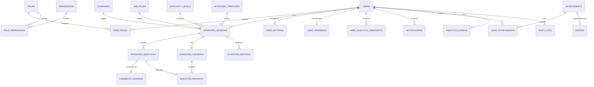

# InterviewIQ AI — Production Database Design

**Document status:** Draft for architecture review  
**Database platform:** MySQL 8.0+ / InnoDB / utf8mb4  
**Design principle:** Relational 3NF with auditable ownership, controlled reference data, and privacy-aware retention

## Database Goals

- Serve as the authoritative, transactionally consistent system of record for users, interviews, answers, feedback, reports, and operational records.
- Preserve third normal form (3NF): each table represents one business concept; reference concepts are separated; non-key attributes depend on the key, the whole key, and nothing but the key.
- Enforce referential integrity, ownership relationships, lifecycle validity, and uniqueness in the database where appropriate.
- Support secure, efficient user-scoped access patterns, reporting, analytics, auditability, and controlled retention.
- Allow application instances to scale horizontally without database session state.
- Support safe schema evolution through immutable, versioned migrations.

## Naming Conventions

- Tables and columns use lowercase `snake_case`; table names are plural except clear relationship concepts such as `user_roles`.
- Primary keys are `BIGINT UNSIGNED AUTO_INCREMENT` columns named `id`.
- Foreign keys use `<referenced_entity>_id` (for example, `user_id`, `interview_session_id`).
- All timestamps are `DATETIME(6)` and stored in UTC.
- Every table has `id`, `created_at`, `updated_at`, `created_by`, and `updated_by` as required audit columns. `created_by`/`updated_by` may be `NULL` for system bootstrap or automated/system actions; their application meaning is documented in audit logs.
- Soft-deletable entities use `deleted_at` and `deleted_by`; hard deletion is reserved for transient/non-business records governed by retention policy.
- Boolean flags use `is_` prefixes; status values use `<concept>_status` or `status` and are constrained by approved values.
- Index names use `idx_<table>_<column(s)>`; foreign key names use `fk_<table>_<referenced_table>_<purpose>`; unique constraints use `uq_<table>_<column(s)>`.
- Monetary, credential, and raw audio fields are out of scope for the MVP schema.

## Entity List

| Entity | Purpose |
| --- | --- |
| `users` | Authenticated candidate identity, email, password hash, account status, and privacy lifecycle. |
| `roles` | Controlled application roles such as `USER` and `OPERATIONS`. |
| `permissions` | Granular capability catalog used by role-based access control. |
| `role_permissions` | Many-to-many role-to-permission assignment. |
| `user_roles` | Many-to-many user-to-role assignment with grant metadata. |
| `companies` | Curated target-company catalog for interview setup. |
| `job_roles` | Curated target-job-role catalog. |
| `difficulty_levels` | Controlled difficulty reference data used by sessions. |
| `interview_templates` | Approved interview modes/templates and question-count defaults. |
| `interview_sessions` | User-owned interview aggregate root and lifecycle state. |
| `interview_questions` | Ordered questions generated for an interview session. |
| `candidate_answers` | User-approved text answers or browser transcripts; raw audio is not stored. |
| `interview_feedback` | Structured overall AI feedback for a completed session. |
| `question_feedback` | Per-question feedback linked to feedback and question records. |
| `interview_reports` | Export/report generation state and immutable report reference. |
| `analytics_events` | Privacy-aware product/operational event records; excludes raw answer data. |
| `user_analytics_snapshots` | Materialized user-scoped aggregate metrics for fast dashboard reads. |
| `notifications` | In-app or delivery-channel notification lifecycle. |
| `user_settings` | One-to-one user preferences and notification/interaction choices. |
| `achievements` | Definition catalog for earned progress milestones. |
| `badges` | Display badge catalog associated with achievements. |
| `user_achievements` | User achievement awards and optional badge assignment. |
| `user_progress` | One current, user-scoped progress summary separate from historical analytics. |
| `audit_logs` | Append-only security and business audit record with safe metadata. |

## Relationships

- A **user** has zero or more `user_roles`; each `user_role` joins exactly one user to exactly one role. A role has zero or more permissions through `role_permissions`.
- A **user** owns zero or more `interview_sessions`. Each session references one company, job role, difficulty level, and optional interview template. Reference records remain independently governed so historical sessions remain meaningful.
- An **interview session** contains zero or more ordered `interview_questions`. A question contains zero or one current `candidate_answer`. This models the MVP’s one submitted answer per question; revisions occur before submission, not as hidden duplicates.
- A completed **interview session** can have zero or one current `interview_feedback`; feedback has zero or more `question_feedback` records. The unique session-feedback relationship prevents conflicting current results.
- A completed **interview session** can have zero or more `interview_reports` representing generation attempts/formats. A report never stores a password, token, or raw answer duplication.
- A **user** has zero or one `user_settings`, zero or one `user_progress`, zero or more analytics snapshots, notifications, achievements, and audit-log entries.
- An **achievement** may have zero or one badge; `user_achievements` joins a user to an achievement and records the award. Badge display remains normalized through the achievement reference.
- `analytics_events` and `audit_logs` are append-only history tables. They may reference an actor user and a target user/session but must tolerate retention-driven nullification of references.
- Every table has creator/updater audit references to users. Those references are `SET NULL` on user purge to preserve non-identifying historical records where retention policy permits.

## Index Strategy

- Every primary key and foreign key has an index; MySQL/InnoDB indexes FK columns explicitly in the schema for clarity and predictable query plans.
- `users.email` is unique and supports login; soft-deleted email reuse is intentionally not permitted without an approved account-recovery policy.
- `interview_sessions` indexes `(user_id, status, created_at)` for dashboards/history and lookup of resumable sessions.
- `interview_questions` uniquely indexes `(interview_session_id, sequence_number)`; answers uniquely index `interview_question_id`.
- Feedback/report indexes target `(interview_session_id, status)` and user-access paths resolve through the session owner.
- `notifications` indexes `(user_id, status, created_at)`; analytics events index `(user_id, occurred_at)` and `(event_type, occurred_at)`.
- Audit logs index `(actor_user_id, occurred_at)`, `(target_user_id, occurred_at)`, and `(entity_type, entity_id, occurred_at)` for investigation without scanning raw logs.
- Query plans must be reviewed with realistic volume before adding indexes; redundant indexes are avoided because they increase write cost.

## Foreign Keys

All business relationships use foreign keys, as defined in `database/schema.sql`. The schema uses `RESTRICT` for immutable/reference data and active business ownership, `CASCADE` only for dependent join/detail records that have no independent meaning, and `SET NULL` for audit/history references that must survive user purge. Application authorization still enforces ownership; foreign keys are integrity controls, not authorization.

## Constraints

- Unique constraints prevent duplicate normalized email, role code, permission code, reference-data code, template code, per-session question sequence, per-question answer, per-session feedback, one user settings/progress row, and one user-achievement award.
- Check constraints restrict known status values, positive sequence/question counts, scoring ranges, and nonnegative metrics. The application provides richer validation; database checks protect integrity against bypasses.
- Required relationships use `NOT NULL` FKs. Optional source/template/export references are nullable only where product workflow allows them.
- Answer and feedback content length limits protect storage, provider cost, and abuse boundaries. The backend also enforces request-size limits.

## Cascading Rules

- **User purge:** active users are soft-deleted. Any legally approved hard purge uses a controlled workflow that removes/anonynizes user-owned content first and nullifies creator/updater/audit actor references, never a blind `CASCADE` from `users`.
- **Interview session:** sessions are soft-deleted only through approved retention/account-deletion workflows. Questions, answers, feedback, reports, and question feedback cascade only when a controlled hard purge removes a session.
- **Reference data:** companies, roles, difficulty levels, templates, permissions, achievements, and badges are soft-deleted/deactivated; they are not hard-deleted while referenced.
- **Role assignments and derived records:** user-role, role-permission, notifications, settings, snapshots, and progress may cascade only when their parent is hard-purged under the approved workflow.
- **Audit and analytics events:** related actor/target references use `SET NULL` where allowed; immutable event content is then retained or purged by policy.

## Data Retention

Retention periods require legal/business approval before public launch. The initial policy baseline is: retain active account interview data only while needed for the user experience; retain audit/security data for the approved operational/security period; retain aggregated/de-identified product metrics according to privacy policy; and retain failed provider diagnostic metadata only long enough for troubleshooting. Raw audio is not collected in the MVP. Account deletion/export requests must be implemented as auditable workflows with documented timing, legal-hold exceptions, backup expiry behavior, and verification.

## Soft Delete Strategy

Soft delete applies to user-owned or curated entities whose removal could destroy history or violate audit needs: `users`, `companies`, `job_roles`, `difficulty_levels`, `interview_templates`, `roles`, `permissions`, `achievements`, `badges`, and `interview_sessions`. These tables use `deleted_at` and `deleted_by`; ordinary reads filter `deleted_at IS NULL`. The database does not use soft deletion for append-only audit events or for narrowly dependent rows during a confirmed hard purge. Soft delete is an application lifecycle operation that records actor/time and does not bypass authorization.

## Migration Strategy

Use Flyway or Liquibase (selected through an ADR) with immutable, ordered migration files committed to source control. Migrations execute against disposable MySQL in CI and run through the controlled deployment pipeline. Production changes follow expand–migrate–contract: add backward-compatible structures, deploy compatible application code, backfill/validate through monitored jobs, then remove deprecated structures in a later release. Every destructive migration requires backup verification, rollback/recovery plan, and explicit approval. `database/schema.sql` is the baseline logical schema and must be kept synchronized with the migration history; it is not a substitute for migrations in production.

## Database Dictionary

| Table | Primary Key | Key Columns | Description |
| --- | --- | --- | --- |
| users | id | email, password_hash, status, deleted_at | User identity and account lifecycle. |
| roles | id | code, name, deleted_at | RBAC role reference. |
| permissions | id | code, resource, action, deleted_at | RBAC permission reference. |
| role_permissions | id | role_id, permission_id | Role-permission join. |
| user_roles | id | user_id, role_id | User-role assignment. |
| companies | id | code, name, is_active, deleted_at | Target-company catalog. |
| job_roles | id | code, name, category, deleted_at | Target-role catalog. |
| difficulty_levels | id | code, display_name, rank_order, deleted_at | Difficulty catalog. |
| interview_templates | id | code, name, default_question_count, deleted_at | Interview mode/template catalog. |
| interview_sessions | id | user_id, company_id, job_role_id, difficulty_level_id, status | Interview aggregate and lifecycle. |
| interview_questions | id | interview_session_id, sequence_number, question_text | Ordered generated questions. |
| candidate_answers | id | interview_question_id, answer_text, input_method | Submitted typed/transcript answer. |
| interview_feedback | id | interview_session_id, status, overall_score | Overall structured AI feedback. |
| question_feedback | id | interview_feedback_id, interview_question_id, score | Per-question feedback. |
| interview_reports | id | interview_session_id, format, status, storage_key | Report-generation record. |
| analytics_events | id | user_id, event_type, occurred_at | Privacy-aware event history. |
| user_analytics_snapshots | id | user_id, snapshot_date | Derived user metrics snapshot. |
| notifications | id | user_id, channel, status, notification_type | User notification lifecycle. |
| user_settings | id | user_id, notifications_enabled, locale | User-owned preference row. |
| achievements | id | code, name, deleted_at | Achievement definition. |
| badges | id | achievement_id, code, display_name, deleted_at | Badge definition. |
| user_achievements | id | user_id, achievement_id, awarded_at | Achievement award record. |
| user_progress | id | user_id, completed_interviews, current_streak_days | Current progress summary. |
| audit_logs | id | actor_user_id, entity_type, entity_id, action, occurred_at | Append-only audit history. |

The executable DDL and reference seed data are in [schema.sql](C:\Users\shiva\OneDrive\Documents\InterviewIQ-AI\database\schema.sql) and [seed.sql](C:\Users\shiva\OneDrive\Documents\InterviewIQ-AI\database\seed.sql).
