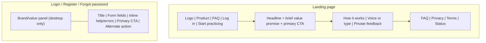
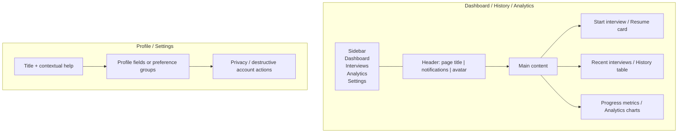
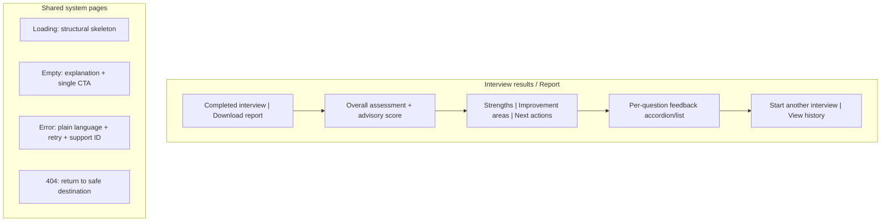
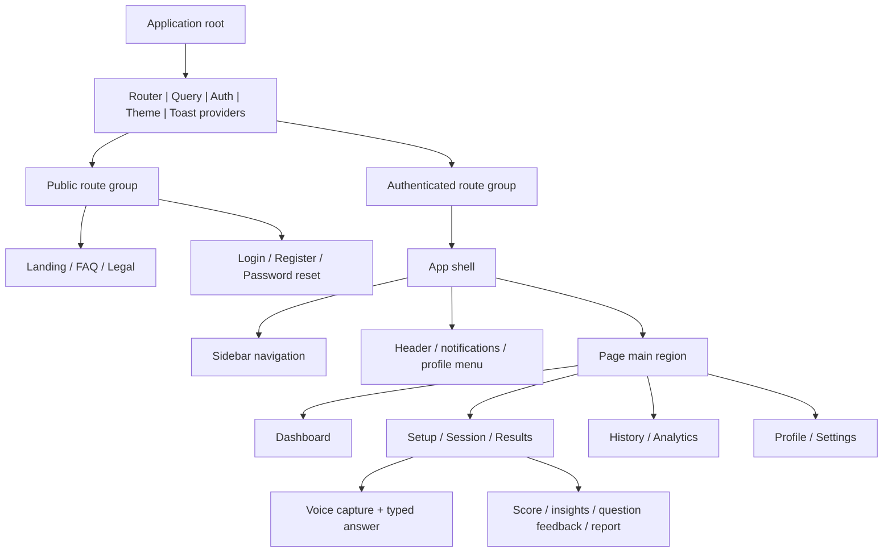
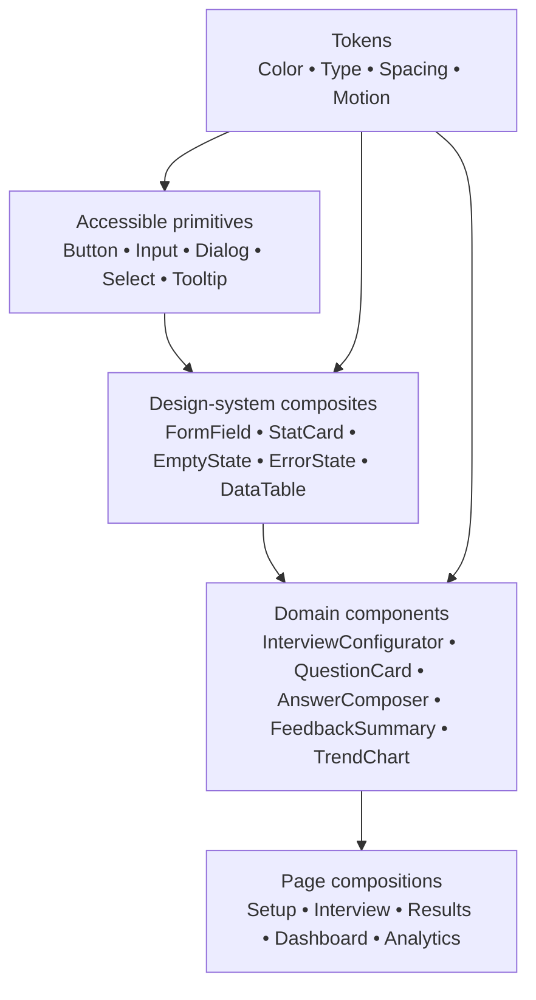

# InterviewIQ AI — UI Design System Specification

**Document status:** Final planning artifact before implementation  
**Audience:** Product design, frontend engineering, QA, accessibility, and content teams  
**Design direction:** Premium, dark-first, calm, highly legible SaaS application

## 1 Design Philosophy

InterviewIQ AI should feel like a focused private coaching space—not a noisy dashboard. The interface makes the next action obvious, keeps high-stakes interview practice calm, and turns AI feedback into understandable progress. The visual language combines Linear’s information clarity, Vercel’s restraint, Stripe’s confidence, and GitHub’s durable interaction patterns without copying any product’s identity.

- **Modern and minimal:** one primary action per view; progressive disclosure for secondary controls.
- **Dark first:** dark is the default, carefully designed rather than inverted; every surface has clear hierarchy.
- **Mobile first:** critical interview and feedback workflows are complete on small screens before desktop enhancements.
- **Accessible by default:** WCAG 2.1 AA is a release requirement, not a polish phase.
- **Human under pressure:** clear progress, low visual noise, calm errors, predictable escape routes, and no manipulative urgency.
- **Deliberate motion:** animation explains state change; it never blocks action or distracts during an interview.

## 2 Brand Identity

### Logo Concept

The mark combines a precise conversation cue with a subtle upward signal: two rounded speech brackets forming an `IQ`-inspired negative space, with a small ascending bar/chevron. It should work as a 20–24 px monochrome app icon, a favicon, and a horizontal lockup. Avoid literal microphones, graduation caps, or generic robot imagery.

### Brand Personality

Focused, intelligent, encouraging, private, and direct. The product is a thoughtful coach: specific without being harsh, optimistic without false reassurance, and professional without sounding corporate.

### Voice & Tone

- Use concise active language: “Start interview,” “Review feedback,” “Try again.”
- Describe AI output as guidance: “Here’s a suggested improvement,” not “You failed.”
- Use plain language for errors: “We couldn’t save that answer. Your text is still here—try again.”
- Avoid claims of hiring prediction, guaranteed outcomes, or human-like authority.
- Use sentence case, not title case, for UI labels unless a proper name requires it.

## 3 Color System

### Semantic Palette

| Token family | Role | Dark value | Light fallback | Usage |
| --- | --- | --- | --- | --- |
| Primary | Action / brand | `#8B5CF6` | `#6D28D9` | Primary CTA, selected states, focus accents |
| Primary strong | Hover / emphasis | `#A78BFA` | `#7C3AED` | Hover and active controls |
| Secondary | Supporting accent | `#22D3EE` | `#0891B2` | Information, links, analytics highlights |
| Success | Positive state | `#34D399` | `#059669` | Completion, healthy status |
| Warning | Attention state | `#FBBF24` | `#B45309` | Caution, pending action |
| Danger | Destructive / error | `#FB7185` | `#E11D48` | Errors, destructive actions |
| Neutral | Muted UI | `#94A3B8` | `#64748B` | Secondary text, icons |
| Background | App canvas | `#0B1020` | `#F8FAFC` | Page background |
| Surface | Raised container | `#121A2B` | `#FFFFFF` | Cards, panels, dialogs |
| Surface elevated | Hover / floating | `#182338` | `#FFFFFF` | Menus, active cards |
| Border | Separation | `#26344D` | `#E2E8F0` | Inputs, dividers, tables |
| Text primary | Main content | `#F8FAFC` | `#0F172A` | Headings/body |
| Text secondary | Supporting content | `#B6C2D4` | `#475569` | Metadata/help text |

### Color Tokens

```text
--color-bg-canvas: #0B1020;
--color-bg-subtle: #0E1627;
--color-surface: #121A2B;
--color-surface-raised: #182338;
--color-surface-selected: #24204A;
--color-border-subtle: #26344D;
--color-border-strong: #3C4B68;
--color-text-primary: #F8FAFC;
--color-text-secondary: #B6C2D4;
--color-text-muted: #7E8DA7;
--color-primary: #8B5CF6;
--color-primary-hover: #A78BFA;
--color-primary-foreground: #FFFFFF;
--color-secondary: #22D3EE;
--color-success: #34D399;
--color-warning: #FBBF24;
--color-danger: #FB7185;
--color-focus-ring: #A78BFA;
```

Never communicate meaning through color alone. Pair status color with a label, icon, pattern, or text. All foreground/background combinations used in text must meet WCAG AA: 4.5:1 for normal text and 3:1 for large text/UI indicators.

## 4 Typography

### Font Family

- **UI/body:** Inter, `ui-sans-serif`, system fallback. It is compact, highly legible, and available through reliable web delivery.
- **Display (optional):** Inter remains preferred; no separate display font is needed in MVP.
- **Code/data:** `JetBrains Mono`, `ui-monospace`, monospace; use only for IDs, timestamps, API snippets, and technical details.

### Type Scale

| Token | Size / line height | Weight | Use |
| --- | --- | --- | --- |
| Display | 40 / 48 px desktop; 32 / 40 mobile | 700 | Landing hero only |
| H1 | 32 / 40 px; 28 / 36 mobile | 700 | Page title |
| H2 | 24 / 32 px | 650–700 | Primary section |
| H3 | 20 / 28 px | 650 | Card/dialog section |
| H4 | 16 / 24 px | 650 | Compact section/title |
| Body L | 16 / 26 px | 400 | Explanatory content |
| Body | 14 / 22 px | 400 | Default UI copy |
| Body S | 13 / 20 px | 400 | Metadata, table text |
| Label | 12 / 16 px | 600 | Inputs, badges, status |
| Button | 14 / 20 px | 600 | All standard buttons |

### Spacing Rules

Use an 8 px base grid. Type blocks have 8 px gap from their supporting copy, 16 px within compact groups, 24 px between sections, and 32–48 px between major page regions. Keep text measure 45–75 characters for long-form feedback; do not use centered long paragraphs.

## 5 Design Tokens

| Category | Tokens | Rule |
| --- | --- | --- |
| Border radius | `r-4: 4px`, `r-8: 8px`, `r-12: 12px`, `r-16: 16px`, `r-pill: 999px` | Inputs/buttons use 8 px; cards 12 px; dialogs 16 px; avatars/pills 999 px |
| Spacing | `s-4, 8, 12, 16, 20, 24, 32, 40, 48, 64` | Use only this scale except one-pixel borders |
| Shadow | `sm`, `md`, `lg`, `focus` | Soft cool-black shadows; surfaces rely on border and tonal contrast first |
| Opacity | `100, 80, 64, 48, 32, 16` | Never reduce essential text below accessible contrast |
| Transition | `fast: 120ms`, `base: 180ms`, `slow: 260ms` | Ease-out for entry, ease-in for exit, linear only for progress |
| Animation | `fade`, `slide-up`, `scale-in`, `shimmer`, `pulse` | Respect reduced motion; no infinite decorative motion |

## 6 Component Library

All components use visible focus rings (2 px primary focus color plus 2 px canvas offset), semantic HTML first, and minimum 44 × 44 px touch targets for mobile interactive controls.

| Component | Purpose | Variants / Sizes | States | Accessibility |
| --- | --- | --- | --- | --- |
| Buttons | Trigger primary, secondary, or destructive action | primary, secondary, ghost, destructive, link; sm/md/lg/icon | default, hover, focus, active, disabled, loading | Native `button`; accessible name; disabled semantics; spinner label; Enter/Space works |
| Inputs | Collect short text/password | text, email, password, search; sm/md/lg | default, filled, focus, invalid, disabled, read-only | `label` always visible or programmatically associated; error via `aria-describedby`; password visibility control labeled |
| Select | Choose finite value | single, searchable; md/lg | closed, open, selected, invalid, disabled | Native select preferred on mobile; combobox follows ARIA pattern; keyboard filtering/navigation |
| Checkbox | Toggle independent option | default, indeterminate; md | unchecked, checked, indeterminate, invalid, disabled | Native checkbox; 44 px hit target; status not color-only |
| Radio | Choose one option | stacked, card radio | unchecked, checked, focus, disabled | Native radio group/fieldset; arrow-key navigation |
| Cards | Group related information | standard, interactive, stat, feedback, outlined | default, hover, selected, disabled | Interactive card is one clear link/button; no nested competing controls |
| Tables | Dense tabular history/catalog data | default, compact, responsive-to-cards | loading, empty, error, sorted | Semantic table/caption/headers; sort buttons announce state; horizontal scroll fallback |
| Dialogs | Confirm or focus a contained task | modal, alert, confirmation, fullscreen-mobile | opening, open, submitting, error | Focus trap; restore trigger focus; Escape closes non-destructive modal; `alertdialog` for urgent confirmations |
| Toast | Announce transient result | success, info, warning, error | entering, visible, dismissing | `role=status` or `alert`; do not use as sole feedback for critical actions; pause on hover/focus |
| Navbar | Public/top product navigation | public, authenticated compact | default, scrolled, mobile open | Landmark nav; current route indicated; menu button has expanded state |
| Sidebar | Desktop navigation | expanded, collapsed, mobile drawer | default, active, hover | `nav` landmark; tooltip when collapsed; drawer traps focus only while open |
| Dropdown | Compact contextual actions | menu, action, user menu | closed, open, disabled | Menu button labels state; arrows/Home/End/Escape follow ARIA menu guidance |
| Tabs | Switch peer views without navigation | underline, segmented | default, active, focus, disabled | Use tablist/tab/tabpanel semantics; arrow navigation; no critical content hidden without alternative |
| Progress | Show completion or loading | determinate, indeterminate, steps | 0–100, active, complete, error | `progressbar` with numeric value for determinate; textual status for indeterminate |
| Charts | Visualize user-owned trends | line, bar, score trend | loading, empty, error, selected point | Text/table alternative; labeled axes; patterns/labels beyond color; keyboard point access when interactive |
| Avatar | Represent account/user | image, initials, icon; xs–xl | default, loading, fallback | Decorative avatar hidden; meaningful avatar has alt text; initials are fallback not identity proof |
| Badge | Communicate compact status/category | neutral, primary, success, warning, danger; sm/md | default, removable | Text always included; removable badge has explicit action label |
| Tooltip | Explain unlabeled/compact control | default, rich (sparingly) | hidden, visible | Never contain essential-only information; appears on focus and hover; Escape dismisses |
| Accordion | Collapse optional detail | single, multiple | collapsed, expanded, disabled | Button/region semantics, `aria-expanded`, keyboard reachable |
| Pagination | Navigate data pages | cursor next/previous, numbered when bounded | enabled, disabled, loading | Announces current range; buttons named “Next results,” not icon-only |
| Loading states | Communicate active work | inline, section, page, blocking operation | initial, retrying, complete | Include text for work >1s; avoid indefinite spinners without context |
| Empty states | Explain absence and next action | first-use, filtered, no-data | default | Clear title, short explanation, single relevant CTA; illustrative art is decorative |
| Error states | Recover safely from failures | inline, page, destructive confirmation | recoverable, blocking | Plain language; preserve input where safe; retry and support/correlation guidance |
| Skeleton loaders | Preserve layout during initial fetch | text, card, table, chart | loading | `aria-busy`; match final layout; no shimmer under reduced motion |

### Component Composition Rules

- Use shadcn/ui primitives as accessible foundations, then wrap them in InterviewIQ design-system components. Do not style every feature ad hoc.
- Form field composition is `Label → control → optional help → error`. Error replaces neither label nor help.
- Destructive actions require explicit text buttons and confirmation dialogs; red is reserved for destructive/error context.
- Empty, loading, error, and success states are required design states for every data-bearing feature.

## 7 Layout System

### Container and Grid

- Desktop application canvas: max-width 1440 px; content max-width 1200 px; 24 px desktop gutters.
- Marketing canvas: max-width 1200 px; 20 px mobile and 32 px desktop gutters.
- Use 12 columns desktop, 8 laptop/tablet, and 4 mobile; 16 px grid gap mobile, 24 px desktop.
- Cards align to grid; avoid deep nested containers and unnecessary borders.

### Sidebar, Header, and Footer

- **Sidebar:** 256 px expanded / 72 px collapsed desktop; contains Dashboard, Interviews, Analytics, Settings, profile menu, and compact support/status link. It becomes a modal drawer below laptop width.
- **Header:** 64 px fixed or sticky application header with page title/breadcrumb, compact actions, notifications, and avatar menu. Avoid fixed headers on the focused interview screen unless necessary.
- **Footer:** Public pages use a concise legal/product footer. Authenticated application pages omit a persistent footer to maximize work area; legal/support links live in settings/profile menu.

### Page Layouts

- **Dashboard:** sidebar + header + responsive stat row, primary “Start interview” panel, resume card, recent history, progress summary.
- **Interview:** distraction-minimized single-column center layout; question/progress header, answer area, persistent but non-obstructive action bar. Desktop max content width 840 px; mobile bottom action bar respects safe area.
- **Authentication:** split layout on desktop (brand/value panel + auth panel), single centered card on mobile. Form max-width 420 px.

## 8 Responsive Breakpoints

| Name | Range | Behavior |
| --- | --- | --- |
| Mobile | 0–639 px | 4-column grid; single column; sidebar becomes drawer; 44 px targets; bottom action bar on interview |
| Tablet | 640–1023 px | 8-column grid; two-column cards when useful; compact header; sidebar drawer |
| Laptop | 1024–1279 px | 12-column grid; collapsed or expanded sidebar based on content; tables remain available with scroll/card fallback |
| Desktop | ≥1280 px | 12-column grid; expanded sidebar; multi-panel dashboard; increased whitespace, never denser text |

Breakpoints respond to available container width where possible. The experience must support browser zoom to 200% without loss of functionality or overlapping controls.

## 9 Page Specifications

| Page | Purpose and hierarchy | Key interactions / states |
| --- | --- | --- |
| Landing page | Hero, concise value proof, “Start practicing” CTA, how-it-works, supported voice/typed guidance, trust/legal, FAQ | Mobile CTA remains visible after hero; no autoplay media; include public loading/404 safeguards |
| Login | Email/password form, reset link, registration link | Inline validation; show/hide password; generic credential error; loading button; session-expiry message |
| Register | Value reminder, email/password/display name form, terms/privacy acknowledgement | Password requirements visible before submit; duplicate-email safe handling; success/verification state |
| Forgot password | Single email form and confirmation state | Never reveal account existence; resend guidance and return-to-login link |
| Dashboard | Next action, resume card, recent interviews, basic progress, helpful first-use empty state | Start/resume CTA; cards link to owned resources; partial-data/error panels retry independently |
| Interview setup | Step-like selection of company, role, difficulty, template, expected duration, voice readiness | Card radios/combobox search; configuration summary; readiness detects capability after user action; typed fallback explicit |
| Interview screen | Progress, question, optional read-aloud control, voice/typed capture, editable transcript, submit/next | Calm timer only if later enabled; voice states visible; answer retained after transient error; cancel confirms consequences |
| Interview results | Overall score/assessment, feedback sections, per-question detail, next action, download report | Feedback pending/failed/retry state; score is advisory; accordions on mobile; report button handles generation state |
| Analytics | Summary metrics, score/completion trends, focus areas, links to source interviews | Text alternatives for charts; range/group filters; useful zero-data state; no implied hiring prediction |
| History | Search/filter/sortable interview list with status, date, role, score and resume/result action | Responsive table-to-card transformation; pagination; filter empty state; non-disclosing missing item behavior |
| Profile | Basic personal details and data/privacy links | Clear edit/save/cancel; success confirmation; account deletion is isolated destructive section |
| Settings | Notification preferences, accessibility/appearance future preferences, security/help links | Group choices by consequence; immediate save confirmation; legal distinction between optional and required messages |
| 404 | Explain route is unavailable, offer Dashboard/Home action | Preserve header where authenticated; no technical stack trace |
| 500 | Acknowledge unexpected issue, retry, correlation ID/support path | Preserve safe local form state; no secrets/details; status page link if approved |
| Loading | Page/section skeleton reflecting final layout | `aria-busy`, descriptive loading text for longer work, no endless uncontextualized spinner |

### Major Page Wireframes

```mermaid
flowchart TB
  subgraph Setup["Interview setup"]
    SetupTitle["Back | Set up your interview"]
    Config["Company | Role | Difficulty | Template"]
    Ready["Voice readiness + typed fallback"]
    Summary["Session summary + Start interview"]
    SetupTitle --> Config --> Ready --> Summary
  end
  subgraph Interview["Interview screen"]
    IProgress["Question 2 of 5 | progress bar | exit"]
    IQuestion["Question text | optional read aloud"]
    IAnswer["Voice controls OR typed answer | editable transcript"]
    IAction["Save answer | Next question"]
    IProgress --> IQuestion --> IAnswer --> IAction
  end
```









## 10 Animation Guidelines

### Framer Motion Recommendations

Use Framer Motion only for state transitions that benefit from interpolation: route entry, dialogs, sidebar drawer, cards, feedback reveal, and skeleton presence. Use CSS transitions for simple color/opacity/focus changes. Animate transform and opacity; avoid layout-thrashing properties such as width/height when a transform or layout animation will do.

- **Hover:** buttons/icons shift color or 1–2 px elevation over 120 ms; no bouncing or large scale changes.
- **Page transition:** 160–220 ms opacity + 8 px vertical offset; preserve focus and do not delay navigation semantics.
- **Loading:** skeleton fade/shimmer at low contrast; progress states include text; spinner uses 700–900 ms rotation.
- **Modal:** 180 ms backdrop fade and 180–220 ms scale/slide-in; focus moves only after mount.
- **Sidebar:** desktop collapse 180 ms; mobile drawer 220 ms slide + backdrop; never trap user mid-animation.
- **Cards:** interactive card border/surface transition 120 ms; no full-card motion for list scanning.
- **Reduced motion:** honor `prefers-reduced-motion`; remove movement, shimmer, and automatic chart animation while retaining instant state changes.

## 11 Accessibility

### Keyboard Navigation

All interactive elements are reachable in a logical order. Tab moves forward, Shift+Tab backward, Enter/Space activates buttons, Escape dismisses appropriate overlays, arrow keys operate radios/tabs/menus according to their native patterns, and no keyboard trap exists outside active modal dialogs. A visible “Skip to main content” link appears on public and authenticated shell pages.

### Focus States

Focus is always visible, never removed globally, and uses `--color-focus-ring` with sufficient contrast. On route changes, focus moves to the main page heading; after dialog close, it returns to the invoking control; after inline form errors, focus moves to the first invalid control or an error summary based on error count.

### ARIA and Semantics

Prefer native semantic elements. ARIA enhances—not replaces—semantic HTML. Use landmarks (`header`, `nav`, `main`, `footer`), labeled form controls, live regions for asynchronous save/AI progress, `aria-current` for navigation, `aria-expanded` for disclosure, and correct dialog/menu/tab patterns. Do not add ARIA roles that conflict with native semantics.

### Color Contrast and Screen Readers

Text, control boundaries, charts, focus indicators, and status indicators meet WCAG 2.1 AA thresholds. Every chart has a textual summary/table alternative. Icons paired with essential actions have visible text or an accessible name. Decorative images/icons are hidden from screen readers. Voice functionality remains optional; typed answering supports every interview task.

## 12 Icons

Use Lucide Icons as the sole MVP interface icon library. Use 20 px in standard controls, 16 px in dense metadata, and 24 px for primary empty/state illustration anchors. Stroke width remains consistent with the library default.

- Pair unfamiliar icons with text. Icon-only controls require tooltips and precise accessible labels.
- Favor `Play`, `Mic`, `MicOff`, `FileDown`, `ChartNoAxesCombined`, `Settings`, `Bell`, `ChevronRight`, `CircleAlert`, and `CircleCheck` only when their meaning is clear in context.
- Do not use icons as decoration inside every label; preserve visual quiet.
- Do not use emoji as product icons or encode status exclusively in an icon.

## 13 Dark Theme

Dark theme is the default and primary visual target. It uses cool navy-neutral surfaces rather than pure black, providing depth with surface elevation and subtle borders. Purple is reserved for action/selection; cyan supports information and data visualization. Avoid large saturated purple fields, gray-on-gray text, or low-contrast disabled controls.

Light theme may be added later using the same semantic token names, never by hard-coding component colors. If a system preference is respected in the future, default behavior must remain deterministic and user-selectable in Settings. Images/charts must be evaluated specifically in dark mode; logos retain an accessible monochrome variant.

## 14 Future UI Enhancements

- Light theme and refined appearance preferences.
- Guided onboarding/checklists personalized to interview goals.
- Resume-informed setup and privacy consent surfaces.
- Expanded accessibility settings: reduced density, dyslexia-friendly font option, font scaling, high contrast.
- Richer analytics exploration with comparison mode and export.
- Coach/team sharing controls with explicit consent and audit visibility.
- Video interview UI and media consent/reliability states.
- Multi-language layout and right-to-left design readiness.
- Command palette and keyboard shortcuts for experienced users.

## Component Hierarchy Diagrams





---

**Implementation handoff:** Frontend engineers should implement semantic tokens and accessible primitives first, build composed states next, then assemble page features. Any visual exception must be documented and reviewed against the design principles, responsive rules, and WCAG 2.1 AA requirements before merging.
